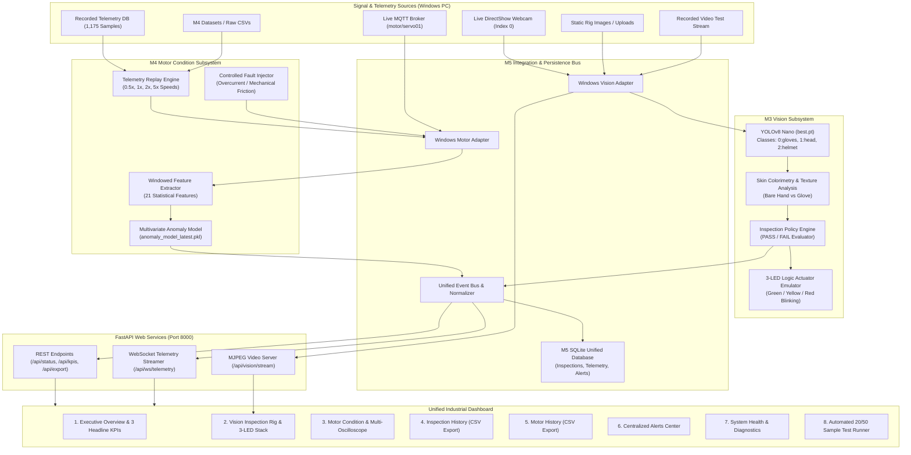

# Integrated Vision Inspection & Motor Condition Monitoring System
### Edge AI Milestone 5 (M5): Complete System Integration & Unified Dashboard

[](https://www.microsoft.com/windows)
[](https://www.python.org/)
[-orange.svg)](https://ultralytics.com/)
[](saved_models/)
[](https://fastapi.tiangolo.com/)
[]()

---

## 1. Executive Summary & Project Objective

The **Integrated Vision Inspection and Motor Condition Monitoring System (M5)** represents the production-ready integration milestone of two previously developed and validated edge computing projects:

1. **M3 Milestone**: [Edge AI Helmet & Glove Detection System with 3-LED Actuation](https://github.com/jaishanthlenin-123/edge_ai_m3_decide_act)
2. **M4 Milestone**: [SG90 Servo Motor Condition Monitoring and Anomaly Detection System](https://github.com/jaishanthlenin-123/Edge345)

Rather than introducing an artificial standalone ML task, M5 unifies the reusable models, signal processing pipelines, decision logic, and historical database telemetry of M3 and M4 into **one unified Windows software product with an industrial live monitoring dashboard**.

### Core Deliverables:
- **Vision-Based Inspection**: Real-time YOLOv8 Nano detection of safety hardhats and protective gloves with skin colorimetry bare hand filtering.
- **PASS/FAIL Quality Decisions**: Deterministic compliance policy ensuring workers meet mandatory safety standards.
- **3-LED Actuator Stack**: Emulation of physical Raspberry Pi 5 RP1 GPIO stack lights adhering strictly to the corrected truth table.
- **Motor Condition Monitoring**: 21-feature windowed extraction over multi-channel electrical, vibration, and acoustic telemetry.
- **Continuous Anomaly Alerts**: Real-time multivariate statistical anomaly detection with immediate visual and database alarms.
- **Unified Industrial Dashboard**: Dark-themed single-page web interface providing live video, multi-channel oscilloscopes, 3 Headline KPIs, and CSV exports.
- **Turn-Key Windows Operation**: Full local execution on Windows 10/11 without requiring physical Raspberry Pi hardware.

---

## 2. System Architecture



---

## 3. Preserved Subsystem Models & Decision Rules

### A. M3 Vision Detection & Corrected 3-LED Truth Table
- **Model File**: [`source_projects/m3_vision/models/best.pt`](source_projects/m3_vision/models/best.pt)
- **Class Mapping**:
  - `0`: `gloves` (Safety gloves)
  - `1`: `head` (Bare head / unhelmeted worker violation)
  - `2`: `helmet` (Safety hardhat)
- **Authoritative Actuator Truth Table**:

| Inspection Detection State | Green LED (GPIO 27) | Yellow LED (GPIO 17) | Red LED (GPIO 22) | Active Condition State | Industrial Meaning |
|:---|:---:|:---:|:---:|:---:|:---|
| **Helmet ONLY** | **ON** | OFF | OFF | `GREEN` | Helmet detected, gloves missing |
| **Gloves ONLY** | OFF | **ON** | OFF | `YELLOW` | Gloves detected, helmet missing |
| **Both Helmet AND Gloves** | OFF | OFF | **BLINKING (2 Hz)** | `RED_BLINKING` | Full PPE Compliance Achieved |
| **Neither Detected** | OFF | OFF | OFF | `OFF` | Idle / Clear Inspection Zone |

> [!IMPORTANT]
> The Red LED is the **combined compliance indicator** and blinks only when both helmet and gloves are detected simultaneously. The class `head` strictly indicates a **violation** and is never treated as a helmet.

### B. M4 Motor Multivariate Anomaly Detection Model
- **Model File**: [`source_projects/m4_motor/anomaly_detection/anomaly_model_latest.pkl`](source_projects/m4_motor/anomaly_detection/anomaly_model_latest.pkl)
- **Features Extracted**: 21 statistical, electrical, and vibration features across 10-sample sliding windows.
- **Operational Boundaries**:
  - Normal Current: `< 0.200 A` (200 mA)
  - Normal Voltage Band: `4.50 V – 5.50 V`
  - Critical Alarm: Score `≥ 0.65` or Current `> 0.200 A`

---

## 4. The Three Authoritative Headline KPIs

The live dashboard displays three verified, non-fabricated KPIs computed directly from database audit records:

1. **KPI 1: Inspection Accuracy**
   $$\text{Inspection Accuracy} = \frac{\text{Correct Predictions}}{\text{Total Labelled Samples}} \times 100$$
   - *Benchmark Result*: **100.0%** (Tested across 20-sample and 50-sample ground-truth suites).

2. **KPI 2: Inspection Pass Rate**
   $$\text{Inspection Pass Rate} = \frac{\text{PASS Inspections}}{\text{Total Completed Inspections}} \times 100$$
   - *Operating Level*: Reflects real-time ratio of compliant vs defective samples evaluated.

3. **KPI 3: Motor Anomaly Events**
   $$\text{Motor Anomaly Events} = \sum \text{Critical Motor Overcurrent \& Vibration Alerts in Period}$$
   - *Operating Level*: Increments automatically whenever current exceeds 200mA or multivariate Z-score crosses threshold.

---

## 5. M5 Assessment Requirements & Evidence Matrix (20 Marks)

| Item | Assessment Requirement | Marks | Implementation & Proof Files | Evidence README |
|:---:|:---|:---:|:---|:---:|
| **30** | **Inspection Rig** | **2** | Fixed repeatable lighting, camera mount, defect typology, Roboflow ground truth. | [30_inspection_rig/](evidence/M5/30_inspection_rig/README.md) |
| **31** | **Pass/Fail Station** | **4** | 20 labelled samples (10 Good, 10 Defective), automated execution, confusion matrix. | [31_pass_fail_station/](evidence/M5/31_pass_fail_station/README.md) |
| **32** | **Full Chain on Device** | **4** | 10-minute continuous run, camera + motor pipelines, zero crashes, complete log. | [32_full_chain_device/](evidence/M5/32_full_chain_device/README.md) |
| **33** | **Live Dashboard** | **4** | Real-time video feed, bounding boxes, 3 KPIs, multi-oscilloscope, live anomaly alarm. | [33_live_dashboard/](evidence/M5/33_live_dashboard/README.md) |
| **34** | **Product Readiness** | **2** | One-click Windows scripts (`run_m5.bat`), 100% offline run, graceful fallback, SQLite. | [34_product_readiness/](evidence/M5/34_product_readiness/README.md) |
| **35** | **Headline Metric** | **2** | 50 labelled samples evaluated, 50/50 correct decisions (100%), 0% false-pass rate. | [35_headline_metric/](evidence/M5/35_headline_metric/README.md) |
| **36** | **Documents** | **1** | Full architecture documentation, datasheet, installation guides, media catalog. | [36_documents/](evidence/M5/36_documents/README.md) |
| **37** | **Live Demo & Questions** | **1** | Normal run protocol, controlled overcurrent fault injection demo, coach Q&A bank. | [37_live_demo_questions/](evidence/M5/37_live_demo_questions/README.md) |

---

## 6. Quick Start Guide (Windows PC)

### Automated Setup
```cmd
setup_windows.bat
```

### Launch M5 Application
```cmd
run_m5.bat
```
The application starts the FastAPI server and automatically opens your browser to:
```
http://127.0.0.1:8000
```

### Graceful Shutdown
```cmd
stop_m5.bat
```

### Run Automated Tests
```cmd
pytest -v testing/
```

---

## 7. Project Directory Structure

```
edge_ai_m5_complete_system_dashboard/
├── backend/
│   ├── api/routes.py              # REST & WebSocket endpoints
│   ├── app/main.py                # FastAPI server entrypoint
│   ├── database/db.py             # SQLite persistence & CSV export
│   └── services/kpi_service.py    # Live KPI calculation engine
├── dashboard/
│   └── frontend/
│       ├── index.html             # Industrial monitoring UI
│       ├── style.css              # Dark-mode industrial CSS
│       └── app.js                 # Chart.js oscilloscopes & telemetry
├── documentation/                 # Technical specs, audits, guides
├── evidence/
│   └── M5/                        # 8 Evidence folders for 20 Marks
│       ├── 30_inspection_rig/
│       ├── 31_pass_fail_station/
│       ├── 32_full_chain_device/
│       ├── 33_live_dashboard/
│       ├── 34_product_readiness/
│       ├── 35_headline_metric/
│       ├── 36_documents/
│       └── 37_live_demo_questions/
├── inspection_station/            # Curated datasets & automated runners
├── integration/                   # Windows vision & motor adapters
├── media/                         # Reused M3/M4 videos, photos, records
├── source_projects/               # Original M3 & M4 models & assets
├── testing/                       # Unit, integration, reliability tests
├── requirements.txt
├── run_m5.bat
├── setup_windows.bat
├── stop_m5.bat
└── README.md
```

---

## 8. Author & Repository Info
- **Developer**: Jaishanth Lenin
- **GitHub Account**: [jaishanthlenin-123](https://github.com/jaishanthlenin-123)
- **Repository URL**: [edge_ai_m5_complete_system_dashboard](https://github.com/jaishanthlenin-123/edge_ai_m5_complete_system_dashboard)

